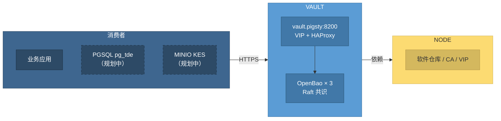

[OpenBao](https://openbao.org/) 是 HashiCorp Vault 改为 BSL 许可证之后，由社区分叉并在 Linux 基金会托管的开源密钥与机密管理系统（MPL-2.0），API 与 Vault 基本兼容。
Pigsty 的 **VAULT** 模块在固定分组 `vault` 上部署一套 OpenBao 集群，作为整套部署的 KMS（密钥管理服务）与机密存储，由 Pigsty 统一管理 TLS、自动解封、高可用入口、备份、监控与生命周期。

> [!NOTE] 当前状态：Beta 模块
> VAULT 模块处于 Beta 状态：服务端的部署、扩缩容、滚动更新、自动解封、HA 入口、每日快照与监控告警已在三节点沙箱中完成验收。
> PGSQL `pg_tde` 与 MINIO KES 的 **自动接入尚未实现**，目前需要手工配置。用于严肃生产环境前，请务必在自己的环境中充分演练，特别是快照恢复流程。

VAULT 沿用 MINIO 模块与 Silo 引擎的命名先例：Pigsty 层使用模块名（`vault` 分组、`vault_*` 参数、`vault.yml` 剧本、`files/pki/vault/` 目录），操作系统层使用引擎名（`openbao.service` 服务、`/etc/openbao/` 配置目录、`bao` 命令行）。


--------

## 模块能力

VAULT 模块当前提供：

- **拓扑即模式**：1 个成员为实验环境，3 个成员为生产环境，没有额外的模式参数；使用 OpenBao 内置的 Raft 存储，不依赖 ETCD 或外部数据库
- **自动解封**：使用 static seal，32 字节解封密钥在管理节点生成并分发到各成员，节点重启后自动解封，无需人工输入密钥分片
- **安全初始化**：仅由 `vault_seq` 最小的成员执行一次 `bao operator init`，并在探测所有成员状态后才动手；扩容、重建成员永远不会意外引导出第二套空集群
- **全链路 TLS**：使用 Pigsty CA 签发服务端证书，最低 TLS 1.3；客户端统一通过 `https://vault.pigsty:8200` 访问
- **高可用入口**：复用 NODE 模块的 L2 VIP 与 HAProxy，TLS 透传到当前的 active 成员，成员故障时自动切换
- **开箱即用**：默认启用 `secret/`（KV v2）、`transit/`（加密即服务）与 `approle` 认证方式，部署完成即可供业务使用
- **滚动更新**：配置、证书、解封密钥或 systemd 单元变化时，逐个重启成员，并等待其重新入群后再处理下一个
- **每日快照**：每个成员每天从 active 成员拉取一份 Raft 快照，本地保留 7 份；集群首次初始化后立即生成一份快照并回收到管理节点
- **完整可观测性**：Prometheus 指标经 HTTPS 采集，14 条记录规则、6 条告警规则，以及 Vault Overview 监控面板；服务日志与备份日志进入 VictoriaLogs
- **删除护栏**：`vault_safeguard` **默认开启**（这是 Pigsty 中唯一默认开启的删除保险）；删除时绝不触碰管理节点上的密钥材料


--------

## 模块架构

VAULT 模块依赖 [`NODE`](/docs/node) 模块完成节点纳管、软件仓库、共享 CA 与 L2 VIP，依赖 [`INFRA`](/docs/infra) 模块提供 VictoriaMetrics、VictoriaLogs、Grafana 与 Alertmanager。
它不依赖 [`ETCD`](/docs/etcd) 与 [`PGSQL`](/docs/pgsql)；相反，PGSQL（`pg_tde` 透明加密）与 MINIO（KES 服务端加密）是它规划中的消费者。



在一套 Pigsty 部署中，只需要一套 VAULT 集群。所有消费者通过同一个域名访问它，并使用各自独立的 mount、policy 与凭据实现隔离。

信任根放在管理节点上：解封密钥、root token 与恢复密钥都保存在 `files/pki/vault/` 目录中，与 Pigsty CA 私钥 `files/pki/ca/ca.key` 放在一起。
这与 Pigsty 既有的安全模型一致：**备份好 `files/pki` 目录，就备份了全部信任根**。


--------

## 组件与端口

| 组件 | 用途 | 端点 |
|:---|:---|:---|
| OpenBao API | 客户端访问、成员间请求转发、Prometheus 指标 | `<节点IP>:8200`、`127.0.0.1:8200` |
| OpenBao Raft | 成员间 Raft 复制与选举 | `<节点IP>:8201` |
| HAProxy 入口 | VIP 上的 HA 入口，TLS 透传至 active 成员（仅启用 VIP 时） | `<VIP>:8200` |
| `vault-backup` | 每日 Raft 快照脚本，由 cron 调度 | `/usr/local/bin/vault-backup` |
| `bao` | OpenBao 命令行工具，环境变量由 `/etc/profile.d/bao.sh` 设置 | 本机 |
{.full-width}

OpenBao 只监听节点 IP 与回环地址，不监听 `0.0.0.0`，从而把 `<VIP>:8200` 留给 HAProxy。因此无论实验环境还是生产环境，客户端端口始终是 `8200`。


--------

## 能力边界

VAULT 是一个刻意保持简单的固定平台。以下事项 **当前不做**，使用前请确认可以接受：

- **消费者自动接入尚未实现**：PGSQL `pg_tde` 与 MINIO KES 的 mount、policy 与凭据目前需要手工配置；`tde/<pg_cluster>` 与 `kes/<minio_cluster>` 这两个路径前缀为它们预留
- **static seal 的安全边界**：自动解封密钥就在成员节点上，无法防御 VAULT 节点或管理节点被攻破；它保护的是数据盘、备份与快照的泄露（参见 [FAQ](/docs/vault/faq#自动解封安全吗)）
- **长效凭据**：root token 保留在管理节点；备份令牌有效期 10 年，与 Pigsty 证书的有效期同一量级，不引入 Agent 或续期组件
- **不提供声明式业务对象**：没有类似 `vault_apps` 的参数，业务应用的 policy 与 AppRole 需要通过 `bao` 命令手工创建
- **快照只保存在本地**：每个成员在本地保留 7 份快照，异地复制属于运维职责；快照恢复是手工流程
- **不支持外部 Vault**：不接管已有的 HashiCorp Vault 或托管 KMS


--------

## 平台支持

`openbao` 软件包由 Pigsty Infra 仓库提供（当前版本 `2.7.2`，官方原生构建），包含在默认的 `infra-package` 软件包别名中，覆盖 Pigsty 支持的全部平台：

| 架构 | 支持的系统 |
|:---|:---|
| `x86_64` | EL 8/9/10、Debian 12/13、Ubuntu 22/24/26 |
| `aarch64` | EL 8/9/10、Debian 12/13、Ubuntu 22/24/26 |
{.full-width}


--------

## 文档目录

| 文档 | 说明 |
|:---|:---|
| [集群配置](/docs/vault/config) | 单节点与三节点拓扑、VIP 入口、域名解析、密钥材料与文件布局 |
| [参数列表](/docs/vault/param) | 8 个公开参数，以及刻意固定的约定 |
| [预置剧本](/docs/vault/playbook) | `vault.yml` 与 `vault-rm.yml` 的任务、标签与命令速查 |
| [管理预案](/docs/vault/admin) | 创建、扩缩容、重建成员、更新证书、备份、恢复与销毁 |
| [使用方法](/docs/vault/usage) | 通过 `bao` 与 HTTP API 使用 KV、Transit 与 AppRole |
| [监控告警](/docs/vault/monitor) | 监控面板、采集方式、日志与告警规则 |
| [指标列表](/docs/vault/metric) | 记录规则与常用原始指标 |
| [常见问题](/docs/vault/faq) | 规模选择、自动解封、初始化保护与排障 |
{.full-width}


--------

## 快速开始

在 [配置清单](/docs/setup/config) 中定义 `vault` 分组，并把服务域名 `vault.pigsty` 解析到该成员：

```yaml
all:
  children:
    vault: { hosts: { 10.10.10.10: { vault_seq: 1 } }, vars: { vault_cluster: vault } }
  vars:
    node_etc_hosts: [ '10.10.10.10 vault.pigsty' ]   # 所有节点通过域名访问 vault
```

完成 [`NODE`](/docs/node) 纳管后，执行 [`vault.yml`](/docs/vault/playbook#vaultyml) 剧本：

```bash
./node.yml  -t node_hosts          # 将 vault.pigsty 写入所有节点的 /etc/hosts
./vault.yml -l vault               # 部署 vault 集群（也可使用 bin/vault-add）
```

在 [`deploy.yml`](/docs/setup/playbook) 中，事先定义好的 `vault` 分组会自动部署，无需再单独执行 `vault.yml`。

部署完成后，在成员节点上以 root 身份检查集群状态：

```bash
sudo -i bao status                 # Initialized=true, Sealed=false 即为正常
```

集群的 root token 保存在管理节点的 `files/pki/vault/init.json` 中，请参考 [使用方法](/docs/vault/usage) 开始使用；在 Grafana 中打开 **Vault Overview** 面板即可查看集群状态。
